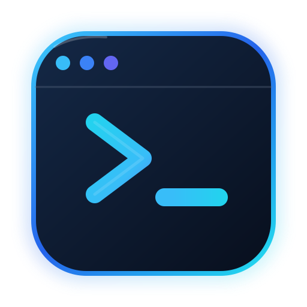

# DevPilot AI

<p align="center">
  
</p>

<p align="center">
  <strong>An AI engineering assistant for safer, reviewable code changes.</strong>
</p>

**An AI-powered developer assistant for working with code repositories, running agent tasks, and reviewing proposed code changes.**

[](https://www.npmjs.com/package/@sohamsig/devpilot-ai)
[](LICENSE)
[](https://fastapi.tiangolo.com/)
[](https://go.dev/)

DevPilot AI is an early-stage developer-tooling project exploring how AI coding agents can work with a developer's repository while keeping code changes reviewable.

The project includes a command-line interface, a Python AI service, and a Go backend. The AI service provides agent execution and a proposal workflow for reviewing changes before applying them.

> **Status:** Active development. The CLI is published on npm. The broader platform and developer experience are evolving.

##  Features

- **Command-line interface** interact with DevPilot AI from your terminal.
- **AI agent runs** send a task to the AI service with an optional workspace path.
- **Repository-aware tools** the agent has tools for listing files, reading files, searching code, and working with proposed changes.
- **Reviewable code proposals** create a proposed file change and inspect its diff.
- **Explicit approval or rejection** approve or reject a proposal through the API and CLI.
- **Service health checks** check whether the AI service is reachable.
- **Local-model workflow** the current agent implementation uses Ollama with `qwen2.5-coder:7b`, avoiding a required paid model API for that path.

##  Architecture

```text
Developer
    |
    v
DevPilot CLI
    |
    v
FastAPI AI Service
    |
    +--> LangGraph agent
    |       |
    |       +--> Repository tools
    |       +--> Local Ollama model
    |
    +--> Change proposal workflow
            |
            +--> Diff
            +--> Approve / Reject
```

The repository also contains a Go backend with chat endpoints and MongoDB persistence. That backend is currently separate from the FastAPI agent workflow.

##  Tech Stack

| Component | Technology |
|---|---|
| CLI | Node.js, JavaScript |
| AI service | Python, FastAPI |
| Agent orchestration | LangGraph / LangChain |
| Local model | Ollama, `qwen2.5-coder:7b` |
| Additional backend | Go, Gin |
| Persistence for Go chat API | MongoDB |
| Frontend | Planned: Next.js, TypeScript, Tailwind CSS |

##  Getting Started

### 1. Install the CLI

```bash
npm install -g @sohamsig/devpilot-ai
```

Verify the installation:

```bash
devpilot --help
devpilot --version
```

### 2. Check the AI service

The CLI expects the FastAPI service at `http://127.0.0.1:8000` by default.

```bash
devpilot doctor
```

To use a different service URL:

```bash
devpilot doctor --url http://127.0.0.1:8000
```

### 3. Run an agent task

```bash
devpilot run "Explain the structure of this repository" --workspace "C:\path\to\your\project"
```

Replace the example workspace path with a repository directory accessible to the running AI service.

### 4. Propose a code change

Prepare the proposed file contents in a text file, then run:

```bash
devpilot proposal src/example.py proposed-content.txt --workspace "C:\path\to\your\project"
```

The CLI sends the file path and proposed contents to the AI service. Inspect the returned proposal ID and diff before deciding what to do.

### 5. Approve or reject a proposal

Use the proposal ID returned by the previous command:

```bash
devpilot approve YOUR_PROPOSAL_ID
```

Or reject it:

```bash
devpilot reject YOUR_PROPOSAL_ID
```

These commands require the proposal to be available to the running service.

##  Running the AI Service Locally

The AI service requires Python dependencies and a working Ollama installation with the configured model available.

From the repository root:

```powershell
cd ai-services
```

Activate the existing virtual environment, if present:

```powershell
.\.venv\Scripts\Activate.ps1
```

If you have not created the environment or installed the dependencies yet, follow the repository's dependency and configuration files first.

Start the service:

```powershell
python -m uvicorn app.main:app --host 127.0.0.1 --port 8000
```

Check its health endpoint:

```powershell
Invoke-RestMethod http://127.0.0.1:8000/health
```

Expected response:

```json
{
  "status": "ok",
  "service": "devpilot-ai",
  "version": "0.7.0"
}
```

The exact version may differ between releases.

### Ollama model

The current agent implementation configures:

```text
qwen2.5-coder:7b
```

Ensure Ollama is installed, running, and has the model available before running agent tasks. Model downloads require sufficient disk space and may take time.

##  API Overview

The FastAPI service currently exposes these endpoints:

| Method | Endpoint | Purpose |
|---|---|---|
| `GET` | `/health` | Check service health |
| `POST` | `/v1/agent/runs` | Run an agent task |
| `POST` | `/v1/changes/proposals` | Create a proposed file change |
| `POST` | `/v1/changes/{proposal_id}/approve` | Approve a proposal |
| `POST` | `/v1/changes/{proposal_id}/reject` | Reject a proposal |

### Example: run an agent task

Request:

```json
{
  "message": "Explain the structure of this repository",
  "workspace_path": "C:\\path\\to\\your\\project"
}
```

Endpoint:

```text
POST /v1/agent/runs
```

The response contains the agent's answer:

```json
{
  "answer": "..."
}
```

The exact answer depends on the model and the repository context available to the agent.

##  Development and Tests

Run the CLI tests:

```bash
cd cli
npm test
```

Run the Python test suite from `ai-services` using the repository's configured Python environment and test dependencies:

```powershell
python -m pytest -q --ignore=sandbox-tests
```

Run the Go backend checks:

```bash
cd backend
go test ./...
```

These commands verify different parts of the project. A successful Go command does not necessarily mean behavior is covered by tests; inspect the test output to see which tests actually ran.

##  Safety Notes

- Review proposed diffs before approving changes.
- Use a workspace directory that the AI service is authorized to access.
- Do not expose the AI service publicly without suitable authentication, access controls, and workspace isolation.
- Never commit API keys, credentials, or local `.env` files.
- Treat model-generated output as untrusted until reviewed and tested.
- The CLI's ability to reach a service does not mean that service can safely access every path supplied by a user.

##  Roadmap

Planned and evolving areas include:

- [ ] Next.js developer workspace UI
- [ ] Improved proposal review experience
- [ ] Stronger integration and end-to-end tests
- [ ] Clearer agent execution and failure reporting
- [ ] Safer workspace isolation and deployment
- [ ] Improved documentation and contributor onboarding

Roadmap items are intentions, not claims that the features are already available.

##  Contributing

Contributions, bug reports, and practical feedback are welcome.

1. Fork the repository.
2. Create a feature branch.
3. Make a focused change.
4. Run the relevant tests.
5. Open a pull request with a clear explanation of the change.

Please include reproduction steps for bugs and tests for behavior changes where practical.

## Author

**Soham Babrekar**

- GitHub: [@Sohamsig](https://github.com/Sohamsig)
- npm: [@sohamsig/devpilot-ai](https://www.npmjs.com/package/@sohamsig/devpilot-ai)
- Project: [DevPilot AI](https://github.com/Sohamsig/DevPilot-AI)

---

*Building DevPilot AI in public exploring practical AI agents, developer tooling, and safer code-change workflows.*

